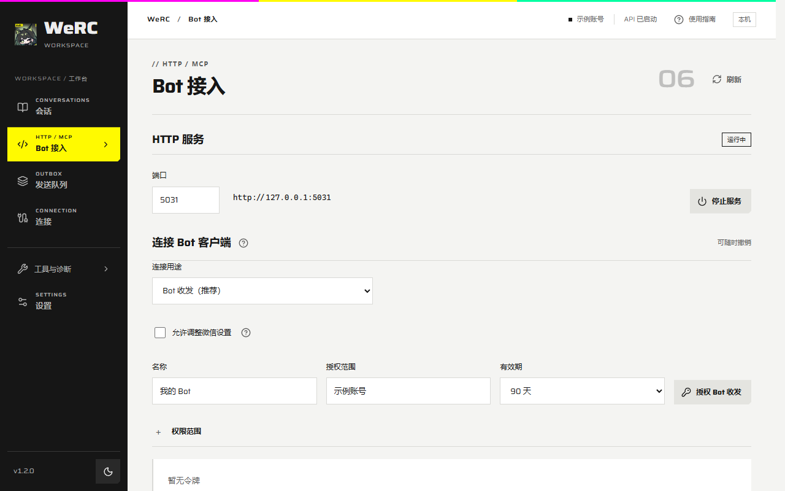

# WeRC

Windows 本机微信工具，支持桌面操作与 Bot 接入。  
A local WeChat companion for Windows, with a desktop app and bot integration.

[下载 / Download](https://github.com/RulerCor/WeRC/releases/latest) · 安装版 / Installer · 便携版 / Portable

## 功能 / Features

- 消息收发，浏览和导出聊天资料。 / Send and receive messages, browse and export chat data.
- 离线归档、语音转写。 / Offline archives and voice transcription.
- 本机 HTTP API 与 MCP；附离线 API 文档。 / Local HTTP API and MCP, with offline API docs.

## 兼容性 / Compatibility

- Windows 10 1903+ / Windows 11（x64）。
- 原生收发支持微信 x64 **4.2.0.53（推荐）、4.2.0.52、4.1.15.13、4.1.13.7** 的匹配构建。WeRC 自动核对核心文件，并显示可用功能。 / Native messaging supports matching WeChat x64 builds of **4.2.0.53 (recommended), 4.2.0.52, 4.1.15.13, and 4.1.13.7**. WeRC checks the core binary and shows available features.
- **4.1.15.9** 可识别适配档案，未开放原生收发。微信设置接口支持匹配的 **4.2.0.53、4.2.0.52** 和原版 **4.1.15.13**。 / WeRC recognizes **4.1.15.9**, but native messaging is disabled. The settings API supports matching **4.2.0.53, 4.2.0.52**, and original **4.1.15.13** builds.
- 请自行安装并登录微信，再按首次启动引导连接。 / Install WeChat separately, sign in, and follow the first-run setup.
- 历史读取取决于本机保存的数据，无法保证完整。4.2.0.53 群引用的接收端跳转尚未确认。 / History depends on locally available data and may be incomplete. Recipient-side group quote navigation on 4.2.0.53 remains unverified.

## 源码 / Source

[从源码构建 / Build from source](docs/building.md) · [API 与 MCP / API and MCP](docs/bot-client.md)

源码公开，WeRC 原创部分和 helper 派生部分仅限非商业用途，其他组件保留各自的许可证。 / Source is public. Original WeRC and helper-derived code are non-commercial; other components retain their own licenses.

[WeRC 许可 / WeRC license](LICENSE) · [第三方许可 / Third-party notices](licenses/THIRD-PARTY-NOTICES.md)
